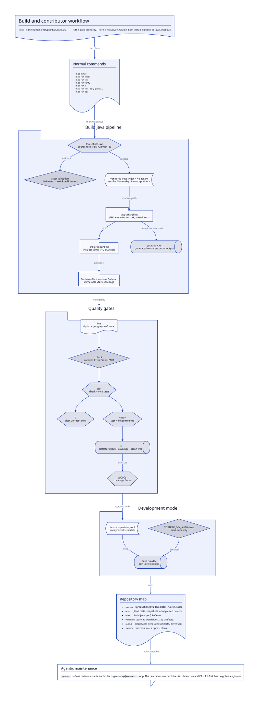

# TokTrak

[![TokTrak — Internal Coding Harness Token Tracker][toktrak-logo]][toktrak]

[toktrak-logo]: sources/toktrak/assets/public/logo-lockup-dark.svg
[toktrak]: https://toktrak.isp-insoft.de

## Why

AI coding subscriptions hide effective consumption behind subsidized flat
pricing. TokTrak gives teams useful projected-cost visibility without pretending
to provide complete billing data or monitoring work content.

TokTrak observes only local coding-harness usage reported by `ccusage`. Cloud,
web, and CI usage are outside its view.

## What

TokTrak is one small web service and one workstation tracker.

The Java 26+ service authenticates company users through OAuth SSO, issues
personal tracker tokens, and presents team totals, averages, leaderboards,
trends, and USD/EUR estimates through a live server-rendered dashboard.

The tracker is one plain Node `.mjs` using the standard library, a pinned
`ccusage`, and the native user scheduler:

| OS      | Scheduler        |
| ------- | ---------------- |
| Windows | `schtasks`       |
| macOS   | LaunchAgent      |
| Linux   | `systemd --user` |

It installs without root or administrator access and uploads daily.

## System overview

Start with the bird's-eye map, then follow the three detail diagrams in order.
The D2 sources live beside the rendered SVGs under `.system`.

### 1. Tracker upload flow

The tracker is intentionally not a Java application. It is one personalized Node
`.mjs` file that installs into the user's account, runs native scheduling,
invokes pinned `ccusage`, uploads bounded JSON, and self-updates only after a
SHA-256 check.

### 2. Runtime

The server is a small Java 26+ JPMS service. It stays stateless except for
`TOKTRAK_DATA_DIR`, writes durable NDJSON through one bounded writer, and
rebuilds the in-memory projection during startup.

### 3. Build and contributor workflow

`mise` is the human entrypoint, but `tools/Build.java` is the build authority.
There is no Maven, Gradle, Spring, servlet container, npm install, bundler, or
DB server.

Run `mise run check`, `mise run test`, `mise run verify`, then `mise run ci` for
progressively stronger guarantees. Use `mise run test --only <paths...>` for
focused iteration without the full ladder. Every pull request, including
Renovate and Golem updates, runs core CI. Changed paths select native tracker
integration on Linux, macOS, and Windows, production container verification,
performance benchmarks, and fresh PIT mutation tests when relevant. Unknown
paths or shared toolchain changes select every check. The required `ci` result
reports each selection and rejects failed or unexpectedly skipped work.
Successful PRs keep results in logs and job summaries without report artifacts.
Performance reports are observational; they do not enforce a slowdown threshold.

## Contribute

See [CONTRIBUTING.md](CONTRIBUTING.md) for platform requirements, repository
layout, generated-code boundaries, and verification commands.

## Install the tracker

1. Install Node.js 22 or newer.
2. Sign in at <https://toktrak.isp-insoft.de>.
3. Create a tracker token.
4. Download `toktrak.mjs` and run it with Node from the download location.

The installer creates a user-scoped daily scheduler without administrator or
root access. It contains the one-time token; do not share it. If it is lost,
revoke it and create another.

## Maintain with golems

The organization GitHub App
[isp-golem-xiv](https://github.com/isp-insoft-gmbh/isp-golem-xiv) runs
maintenance tasks defined in `.golems/`. Shared instructions live in
`.golems/_golems.md`; native `.claude`, `.agents`, `.codex`, and `.pi` project
configs remain in use. The installed App plus these Markdown files are the
integration; TokTrak has no local golem engine or workflow.

Tasks retain their harness, model, effort, runner, schedule, and timeout
preferences. Scheduled tasks use `owner: bugabinga` and Oliver's registered
provider seats in the central ops repository. No TokTrak-specific authentication
cache or repository secret is required.

Ask with `@isp-golem-xiv <task>` on an issue or pull request, or use the App's
Golems dashboard. `canary` is manual-only and read-only: it inspects build
instructions and reports findings without making a change. The App validates
definitions and reports invalid tasks; `mise run check` checks TokTrak, not the
external router's frontmatter contract.

Agents edit the supplied snapshot and report results; the external runner owns
verification, commits, branch publication, and pull requests. Existing explicit
task branches are retained; tasks without one use the App's default
`golems/<name>` branch. CI and human review remain independent of the run.

## Operate

See [OPERATIONS.md](OPERATIONS.md) for production configuration, rootless Podman
deployment, backups, diagnostics, upgrades, rollback, and release.

## License

[MIT](LICENSE)
